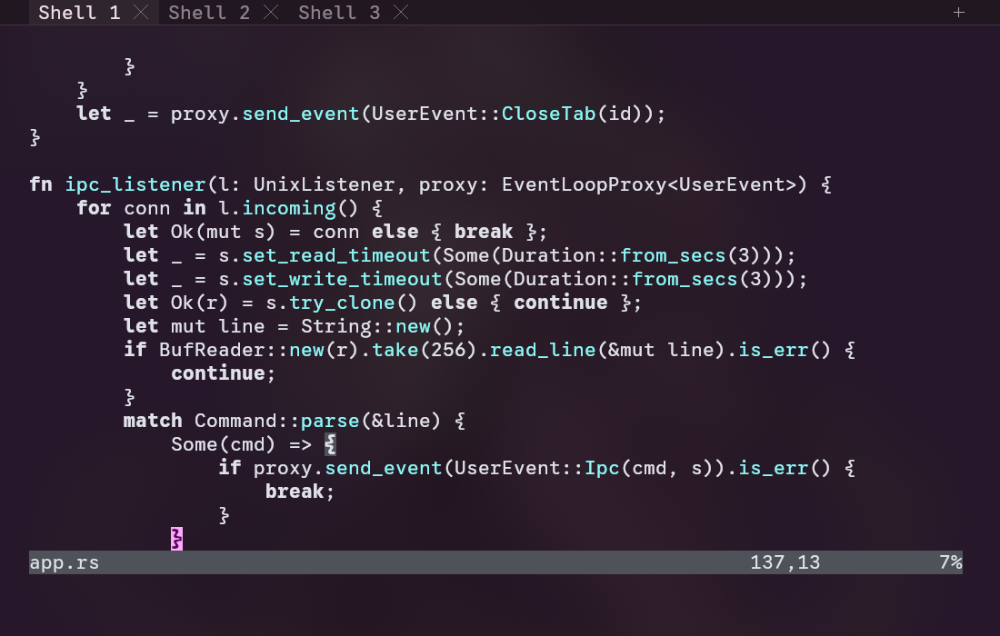

<div align="center">
  
  

  <p>A GPU-accelerated terminal emulator for Linux, written in Rust (winit + wgpu).</p>

  <a href="https://github.com/AeternalAngel/aeternus/actions/workflows/ci.yml"></a>
  <a href="https://github.com/AeternalAngel/aeternus/releases"></a>
  <a href="https://aur.archlinux.org/packages/aeternus"></a>
  <a href="LICENSE"></a>
</div>

🇧🇷 [Leia em português](README.pt-BR.md)

<div align="center">
  
</div>

## Features

- **Fast rendering** on the GPU (Vulkan, or OpenGL ES as a fallback) with a glyph atlas and vsync.
- **Tabs**, an optional **menu bar** and a **Preferences** panel with a built-in color picker.
- **Cursor trail** animation inspired by kitty.
- **Background transparency** (`window.opacity`), with solid text.
- **Text:** truecolor, 256 colors, bold/italic/underline/strikethrough, wide (CJK) characters, color emoji, combining accents, skin-tone modifiers and ZWJ emoji sequences, DEC line drawing.
- **Links:** `Ctrl+click` opens URLs and OSC 8 hyperlinks.
- **Compatibility:** alternate screen, bracketed paste, mouse reporting (1000/1002/1003/SGR), focus events, synchronized output (2026), kitty keyboard protocol (disambiguate level), cursor shapes, OSC 4/7/8/10/11/12/52, tab stops, insert/origin modes and more.
- **Daily use:** 10k-line scrollback with reflow on resize, word/line selection, clipboard and primary selection, zoom, fullscreen, visual bell.
- **Colors in kitty's format:** the same names as kitty (`foreground`, `selection_background`, `color0`…`color255`) and kitty `.conf` themes load directly.
- **Text rendering** with gamma-correct blending like kitty, tunable with `text_composition_strategy`.
- **Config:** a commented `config.toml`, reloaded automatically when it changes, with every shortcut configurable.
- **`aet` command** to control the running window from the shell.

## Install

Requires a Vulkan (or OpenGL ES 3) capable GPU driver and Wayland or X11. Release binaries need glibc 2.36 or newer (Debian 12, Ubuntu 23.04, Fedora 37 or later); on older systems, build from source.

### Arch Linux (AUR)

```bash
yay -S aeternus      # builds from source
yay -S aeternus-bin  # prebuilt binary
```

### Debian / Ubuntu, Fedora / openSUSE

Download the `.deb` or `.rpm` from [Releases](https://github.com/AeternalAngel/aeternus/releases):

```bash
sudo apt install ./aeternus_*.deb
sudo dnf install ./aeternus-*.rpm
```

### AppImage

```bash
chmod +x aeternus-*.AppImage
./aeternus-*.AppImage
```

### Any distribution (tarball)

```bash
tar xzf aeternus-1.4-linux-x86_64.tar.gz
cd aeternus-1.4-linux-x86_64
./install.sh                    # installs to ~/.local (binaries, menu entry, icons, man pages, completions)
sudo ./install.sh --prefix /usr/local   # system-wide
./install.sh --uninstall        # remove it again
```

### From source

```bash
git clone https://github.com/AeternalAngel/aeternus.git
cd aeternus
./install.sh          # builds with cargo, then installs to ~/.local
```

Building needs Rust 1.90 or newer. For a system-wide install, run `cargo build --release` first and then `sudo ./install.sh --prefix /usr/local`. The binaries end up in `target/release/aeternus` and `target/release/aet`.

## Configuration

The file lives at `~/.config/aeternus/config.toml` (or `$XDG_CONFIG_HOME/aeternus/config.toml`) and is created with every option commented out on the first run. Changes are applied as soon as the file is saved; if it has errors, the previous configuration is kept and the errors are logged. Most options can also be changed in **Edit → Preferences**.

```toml
[font]
family = "JetBrainsMono Nerd Font"
size = 14.0

[window]
toolbar = true
opacity = 0.9             # background transparency

[terminal]
shell = "zsh -l"
smart_copy_paste = true   # Ctrl+C copies a selection, Ctrl+V pastes

[cursor]
shape = "bar"
trail = 3                 # enable the cursor trail
trail_decay = [0.1, 0.4]

[colors]
theme = "~/.config/kitty/current-theme.conf"   # any kitty theme works as is
background = "#1e1e2e"    # kitty names; anything here overrides the theme
color1 = "#f38ba8"

[keybindings]
new_tab = ["ctrl+shift+t", "ctrl+t"]
fullscreen = []           # disable F11
```

Use `aeternus --config <path>` to load a different file. Errors and warnings are written to `~/.local/state/aeternus/aeternus.log`.

## Shortcuts

| Action | Default | Config key |
| --- | --- | --- |
| Copy / paste | `Ctrl+Shift+C` / `Ctrl+Shift+V` | `copy`, `paste` |
| Paste primary selection | `Shift+Insert`, middle click | `paste_primary` |
| New tab / close tab | `Ctrl+Shift+T` / `Ctrl+Shift+W` | `new_tab`, `close_tab` |
| Next / previous tab | `Ctrl+Tab`, `Ctrl+PageDown` / `Ctrl+Shift+Tab`, `Ctrl+PageUp` | `next_tab`, `prev_tab` |
| Zoom in / out / reset | `Ctrl+Shift+=` / `Ctrl+Shift+-` / `Ctrl+Shift+0`, `Ctrl+wheel` | `zoom_in`, `zoom_out`, `zoom_reset` |
| Scroll history | `Shift+PageUp` / `Shift+PageDown` / `Shift+Home` / `Shift+End` | `scroll_page_up`, ... |
| Reload config | `Ctrl+Shift+R` | `reload_config` |
| Fullscreen | `F11` | `fullscreen` |
| Preferences | (none) | `preferences` |
| Open link | `Ctrl+click` (`Ctrl+Shift+click` in mouse-aware apps) | |

## The `aet` command

`aet` talks to the most recently focused Aeternus window over a socket in `$XDG_RUNTIME_DIR`:

```bash
aet version   # print the version in the active terminal
aet pref      # open Preferences
aet reload    # reload config.toml
```

## Performance

`aeternus --bench` measures the escape-sequence parser on 64 MB of input. On an Intel Xeon E3-1230 V2 (2012):

| Workload | Throughput |
| --- | --- |
| Plain text | 184 MB/s |
| Colored text | 125 MB/s |
| Full-screen TUI redraws | 118 MB/s |

## Not supported yet

Splits, inline images (sixel / kitty graphics), IME composition (pre-edit) for CJK input, regional-indicator flag emoji, the full kitty keyboard protocol (only the first level), OSC 52 clipboard reading.

## Contributing

See [CONTRIBUTING.md](CONTRIBUTING.md). Bugs and ideas go to [Issues](https://github.com/AeternalAngel/aeternus/issues); security problems to [SECURITY.md](SECURITY.md).

## License

[MIT](LICENSE) © 2026 Gabriel (AeternalAngel)
