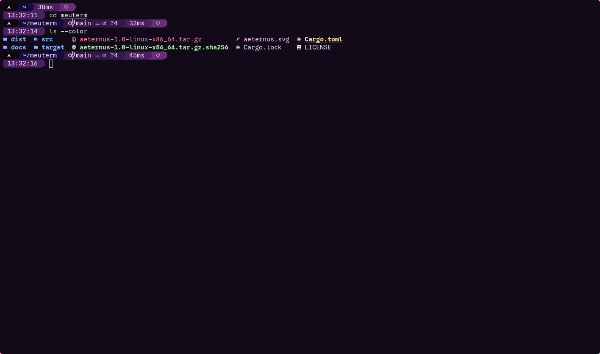

# Aeternus

A GPU-accelerated terminal emulator written in Rust (winit + wgpu) for Linux and Windows.

🇧🇷 [Leia em português](README.pt-BR.md)



> **Status:** version 1.2.1. Expect bugs and missing features. See [CHANGELOG](CHANGELOG.md).

## Install

Download the binary for your platform from [Releases](https://github.com/AeternalAngel/aeternus/releases).

### Linux (x86_64)

```bash
tar xzf aeternus-1.2.1-linux-x86_64.tar.gz
./aeternus
```

Requires a Vulkan-capable GPU driver and Wayland or X11. The binary needs glibc 2.35 or newer (e.g. Debian 12, Ubuntu 23.04, Fedora 37 or later); on older distros, build from source.

### Windows (x86_64)

Extract `aeternus-1.2.1-windows-x86_64.zip` and run `aeternus.exe`. Requires Windows 10 or newer and a GPU driver with Vulkan or DirectX 12 support.

The default shell is `cmd.exe` (changeable in `config.toml`). The default font is a Nerd Font; if it isn't installed, a system font is used as fallback. Installing the font (or editing `font.family` in the config) gives better results.

### Building from source

```bash
git clone https://github.com/AeternalAngel/aeternus.git
cd aeternus
cargo build --release
```

The binary will be at `target/release/aeternus` (Linux) or `target/release/aeternus.exe` (Windows).

## Features

- **Rendering:** wgpu with a glyph atlas and a single draw call; vsync on.
- **Fonts:** cosmic-text with automatic fallback (Nerd Font by default), plus wide characters. Emoji are drawn in monochrome.
- **Compatibility:** 16/256/truecolor (including SGR sub-parameters, e.g. `38:2::r:g:b`), alternate screen, bracketed paste, mouse reporting (1000/1002/1003/SGR), DECSCUSR cursor shapes, synchronized output (DEC 2026), DECRQM, XTVERSION, OSC title/focus, OSC 4/10/11/12 (color set/reset) and OSC 52 (clipboard write only; disable with `terminal.osc52 = false`).
- **Daily use:** 10k-line scrollback, word/line selection, system and primary clipboard, font zoom (Ctrl+wheel).
- **Config:** generated on first run and reloaded with Ctrl+Shift+R. If the file has errors, the previous config is kept and the errors go to stderr on Linux or to `aeternus.log` next to `config.toml` on Windows. `terminal.shell` accepts arguments (e.g. `"bash -l"`), `terminal.working_directory` sets the starting directory and `terminal.osc52` (default `true`) lets programs write to the clipboard via OSC 52.
  - Linux: `~/.config/aeternus/config.toml`
  - Windows: `%APPDATA%\aeternus\config.toml`
- **Command line:** `--version` prints the version and exits; `--config <path>` uses that file instead of the default one; `--bench` runs the parser benchmark.

## Performance

| | Aeternus | kitty |
|---|---|---|
| `cat` of 300k colored lines | 0.24 s | 0.32 s |
| `cat` of 3M lines | 0.81 s | 1.31 s |

Single runs on Linux, taken before wide character support; to be redone.

## Not supported yet

Color emoji, composed emoji, config hot-reload on save, OSC 52 clipboard read (even behind an option), live DPI changes, OSC 8 links, inline images, tabs/splits, line reflow on resize, DEC charsets, configurable keybindings.

## License

[MIT](LICENSE) © 2026 Gabriel (AeternalAngel)
