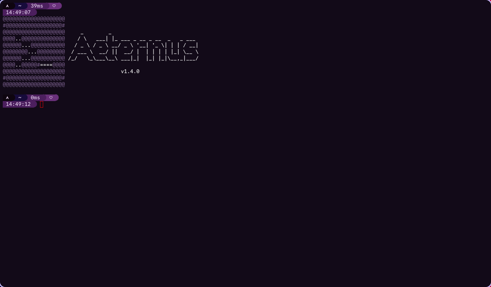

<div align="center">
  
  
</div>

A GPU-accelerated terminal emulator written in Rust (winit + wgpu) for Linux.

🇧🇷 [Leia em português](README.pt-BR.md) (Will be removed in future updates.)

<div align="center">
  
</div>

> **Status:** version 1.4. Expect bugs and missing features. See [CHANGELOG](CHANGELOG.md).

## Install

Download the binary for your platform from [Releases](https://github.com/AeternalAngel/aeternus/releases).

### Linux (x86_64)

```bash
tar xzf aeternus-1.4-linux-x86_64.tar.gz
./aeternus
```

The archive contains `aeternus` and the `aet` companion CLI; put `aet` somewhere in your `PATH` to use it from the shell.

Requires a Vulkan-capable GPU driver and Wayland or X11. The binary needs glibc 2.35 or newer (e.g. Debian 12, Ubuntu 23.04, Fedora 37 or later); on older distros, build from source.

### Building from source

```bash
git clone https://github.com/AeternalAngel/aeternus.git
cd aeternus
cargo build --release
```

The binaries will be at `target/release/aeternus` and `target/release/aet`.

## Features

- **Rendering:** wgpu with a glyph atlas and a single draw call; vsync on.
- **Fonts:** cosmic-text with automatic fallback (Nerd Font by default), plus wide characters and color emoji. Reacts to live DPI changes (e.g. moving the window to a different display).
- **Compatibility:** 16/256/truecolor (including SGR sub-parameters, e.g. `38:2::r:g:b`), alternate screen, bracketed paste, mouse reporting (1000/1002/1003/SGR), DECSCUSR cursor shapes, synchronized output (DEC 2026), DECRQM, XTVERSION, OSC title/focus, OSC 4/10/11/12 (color set/reset) and OSC 52 (clipboard write only; disable with `terminal.osc52 = false`).
- **Daily use:** 10k-line scrollback with reflow on resize, word/line selection, system and primary clipboard, font zoom (Ctrl+wheel).
- **Config:** generated on first run and reloaded automatically when the file changes (or with Ctrl+Shift+R). If the file has errors, the previous config is kept and the errors go to stderr. `terminal.shell` accepts arguments (e.g. `"bash -l"`), `terminal.working_directory` sets the starting directory and `terminal.osc52` (default `true`) lets programs write to the clipboard via OSC 52.
  - Config path: `~/.config/aeternus/config.toml` (or `$XDG_CONFIG_HOME/aeternus/config.toml`)
- **Keybindings:** configurable through a `[keybindings]` section (`copy`, `paste`, `paste_primary`, `reload_config`, `zoom_in`, `zoom_out`, `zoom_reset`, `scroll_page_up`, `scroll_page_down`, `scroll_to_top`, `scroll_to_bottom`), each one taking a list of key combinations (e.g. `["ctrl+shift+c"]`).
- **Toolbar:** `window.toolbar = true` shows the menu bar (File, Edit, View, Help) below the native window frame.
- **Tabs:** create as many shells as you want (`Ctrl+Shift+T`, the `+` button or the File menu). The tab strip shows up with two or more tabs and carries each tab's title, a close button and hover states; `Ctrl+Tab` cycles through tabs and middle-click closes one. When tabs don't fit, the wheel scrolls the strip one tab at a time, `‹`/`›` buttons appear on the right (with a pinned `+`) and it auto-follows the active tab.
- **`aet` commands:** the `aet` CLI talks to the running instance over a Unix socket in `$XDG_RUNTIME_DIR` and targets the most recently focused window: `aet version` prints the version into the active terminal (the shell prompt returns by itself), `aet pref` opens Preferences (handy when the toolbar is off) and `aet reload` reloads `config.toml`.
- **Preferences:** gear button on the bar or the Edit menu opens the settings overlay. The `Simples` mode keeps the everyday options with a built-in color picker (hue/saturation/brightness, live preview, hex/RGB readout); `Avançado` exposes every option grouped in sections. Saving writes `config.toml` (keeping its comments) and applies instantly.
- **Fullscreen:** `F11` or the View menu toggles borderless fullscreen.
- **Command line:** `--version` prints the version and exits; `--config <path>` uses that file instead of the default one; `--bench` runs the parser benchmark.

## Performance

to be redone.

## Not supported yet

Composed emoji, OSC 52 clipboard read (even behind an option), OSC 8 links, inline images, splits, DEC charsets.

## License

[MIT](LICENSE) © 2026 Gabriel (AeternalAngel)
