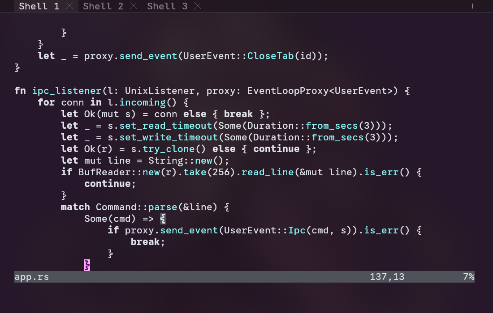

<div align="center">
  
  

  <p>Emulador de terminal acelerado por GPU para Linux, escrito em Rust (winit + wgpu).</p>

  <a href="https://github.com/AeternalAngel/aeternus/actions/workflows/ci.yml"></a>
  <a href="https://github.com/AeternalAngel/aeternus/releases"></a>
  <a href="https://aur.archlinux.org/packages/aeternus"></a>
  <a href="LICENSE"></a>
</div>

> ⚠️ Esta tradução não é mais mantida e pode estar desatualizada. 🇺🇸 Veja o [README em inglês](README.md) para a versão atual.

<div align="center">
  
</div>

## Recursos

- **Renderização rápida** na GPU (Vulkan, ou OpenGL ES como alternativa) com atlas de glifos e vsync.
- **Abas**, **barra de menus** opcional e painel de **Preferências** com seletor de cores.
- Animação de **rastro do cursor** (cursor trail) inspirada no kitty.
- **Fundo transparente** (`window.opacity`), com o texto sólido.
- **Texto:** truecolor, 256 cores, negrito/itálico/sublinhado/tachado, caracteres largos (CJK), emoji coloridos, acentos combinantes, modificadores de tom de pele e sequências ZWJ, desenho de linhas DEC.
- **Links:** `Ctrl+clique` abre URLs e hyperlinks OSC 8.
- **Compatibilidade:** tela alternativa, bracketed paste, mouse (1000/1002/1003/SGR), eventos de foco, saída sincronizada (2026), protocolo de teclado do kitty (nível disambiguate), formatos de cursor, OSC 4/7/8/10/11/12/52, tab stops, modos de inserção/origem e mais.
- **Dia a dia:** 10 mil linhas de histórico com reflow, seleção por palavra/linha, clipboard e seleção primária, zoom, tela cheia, sino visual.
- **Cores no formato do kitty:** os mesmos nomes do kitty (`foreground`, `selection_background`, `color0`…`color255`), e temas `.conf` do kitty carregam direto.
- **Renderização de texto** com mistura gama-correta como no kitty, ajustável com `text_composition_strategy`.
- **Configuração:** um `config.toml` comentado, recarregado sozinho quando muda, com todos os atalhos configuráveis.
- **Comando `aet`** para controlar a janela aberta pelo shell.

## Instalação

Requer driver de GPU com Vulkan (ou OpenGL ES 3) e Wayland ou X11. Os binários das releases precisam de glibc 2.36 ou mais nova (Debian 12, Ubuntu 23.04, Fedora 37 ou posteriores); em sistemas mais antigos, compile do código-fonte.

### Arch Linux (AUR)

```bash
yay -S aeternus      # compila do código-fonte
yay -S aeternus-bin  # binário pronto
```

### Debian / Ubuntu, Fedora / openSUSE

Baixe o `.deb` ou o `.rpm` em [Releases](https://github.com/AeternalAngel/aeternus/releases):

```bash
sudo apt install ./aeternus_*.deb
sudo dnf install ./aeternus-*.rpm
```

### AppImage

```bash
chmod +x aeternus-*.AppImage
./aeternus-*.AppImage
```

### Qualquer distribuição (tarball)

```bash
tar xzf aeternus-1.4-linux-x86_64.tar.gz
cd aeternus-1.4-linux-x86_64
./install.sh                    # instala em ~/.local (binários, atalho no menu, ícones, man pages, completions)
sudo ./install.sh --prefix /usr/local   # para o sistema todo
./install.sh --uninstall        # remove
```

### Do código-fonte

```bash
git clone https://github.com/AeternalAngel/aeternus.git
cd aeternus
./install.sh          # compila com o cargo e instala em ~/.local
```

É preciso Rust 1.90 ou mais novo. Para instalar no sistema todo, rode `cargo build --release` antes e depois `sudo ./install.sh --prefix /usr/local`. Os binários ficam em `target/release/aeternus` e `target/release/aet`.

## Configuração

O arquivo fica em `~/.config/aeternus/config.toml` (ou `$XDG_CONFIG_HOME/aeternus/config.toml`) e é criado com todas as opções comentadas na primeira execução. As mudanças valem assim que o arquivo é salvo; se ele tiver erros, a configuração anterior é mantida e os erros vão para o log. A maioria das opções também pode ser alterada em **Edit → Preferences**.

```toml
[font]
family = "JetBrainsMono Nerd Font"
size = 14.0

[window]
toolbar = true
opacity = 0.9             # transparência do fundo

[terminal]
shell = "zsh -l"
smart_copy_paste = true   # Ctrl+C copia a seleção, Ctrl+V cola

[cursor]
shape = "bar"
trail = 3                 # liga o rastro do cursor
trail_decay = [0.1, 0.4]

[colors]
theme = "~/.config/kitty/current-theme.conf"   # qualquer tema do kitty funciona direto
background = "#1e1e2e"    # nomes do kitty; o que estiver aqui sobrescreve o tema
color1 = "#f38ba8"

[keybindings]
new_tab = ["ctrl+shift+t", "ctrl+t"]
fullscreen = []           # desativa o F11
```

Use `aeternus --config <caminho>` para carregar outro arquivo. Erros e avisos são gravados em `~/.local/state/aeternus/aeternus.log`.

## Atalhos

| Ação | Padrão | Chave na config |
| --- | --- | --- |
| Copiar / colar | `Ctrl+Shift+C` / `Ctrl+Shift+V` | `copy`, `paste` |
| Colar seleção primária | `Shift+Insert`, botão do meio | `paste_primary` |
| Nova aba / fechar aba | `Ctrl+Shift+T` / `Ctrl+Shift+W` | `new_tab`, `close_tab` |
| Próxima aba / aba anterior | `Ctrl+Tab`, `Ctrl+PageDown` / `Ctrl+Shift+Tab`, `Ctrl+PageUp` | `next_tab`, `prev_tab` |
| Zoom + / - / padrão | `Ctrl+Shift+=` / `Ctrl+Shift+-` / `Ctrl+Shift+0`, `Ctrl+roda` | `zoom_in`, `zoom_out`, `zoom_reset` |
| Rolar histórico | `Shift+PageUp` / `Shift+PageDown` / `Shift+Home` / `Shift+End` | `scroll_page_up`, ... |
| Recarregar config | `Ctrl+Shift+R` | `reload_config` |
| Tela cheia | `F11` | `fullscreen` |
| Preferências | (nenhum) | `preferences` |
| Abrir link | `Ctrl+clique` (`Ctrl+Shift+clique` em apps que usam o mouse) | |

## O comando `aet`

O `aet` conversa com a janela do Aeternus focada por último através de um socket em `$XDG_RUNTIME_DIR`:

```bash
aet version   # mostra a versão no terminal ativo
aet pref      # abre as Preferências
aet reload    # recarrega o config.toml
```

## Desempenho

`aeternus --bench` mede o parser de sequências de escape com 64 MB de entrada. Num Intel Xeon E3-1230 V2 (2012):

| Carga | Vazão |
| --- | --- |
| Texto simples | 184 MB/s |
| Texto colorido | 125 MB/s |
| Redesenho de TUI em tela cheia | 118 MB/s |

## Ainda não suportado

Divisão de painéis (splits), imagens inline (sixel / kitty graphics), composição de IME (pré-edição) para entrada CJK, emoji de bandeiras (regional indicators), o protocolo de teclado do kitty completo (só o primeiro nível), leitura do clipboard via OSC 52.

## Contribuindo

Veja o [CONTRIBUTING.md](CONTRIBUTING.md). Bugs e ideias vão para as [Issues](https://github.com/AeternalAngel/aeternus/issues); problemas de segurança, para o [SECURITY.md](SECURITY.md).

## Licença

[MIT](LICENSE) © 2026 Gabriel (AeternalAngel)
