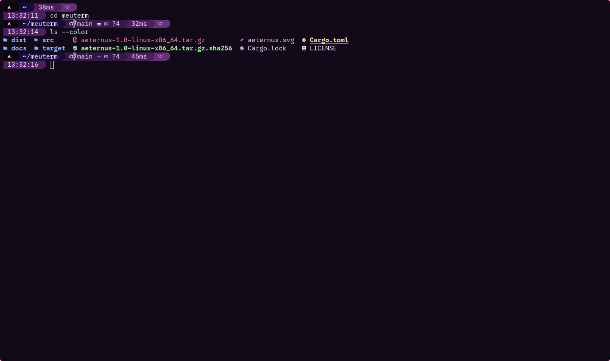

# Aeternus

Emulador de terminal acelerado por GPU, escrito em Rust (winit + wgpu).

🇺🇸 [Read in English](README.md)



> **Status:** primeira versão pública (1.0). Espere bugs e funcionalidades faltando.

## Instalação

Baixe o binário em [Releases](https://github.com/AeternalAngel/aeternus/releases):

```bash
tar xzf aeternus-1.0-linux-x86_64.tar.gz
./aeternus
```

Requer Linux (x86_64), driver de GPU com Vulkan e Wayland ou X11. O binário precisa de glibc 2.44 ou mais nova; em outras distros, compile do código-fonte:

```bash
git clone https://github.com/AeternalAngel/aeternus.git
cd aeternus
cargo build --release
```

## Recursos

- **Renderização:** wgpu com atlas de glifos e uma única chamada de desenho; vsync ligado.
- **Fontes:** cosmic-text com fallback automático (Nerd Font por padrão), além de caracteres largos e emoji coloridos.
- **Compatibilidade:** 16/256/truecolor, tela alternativa, bracketed paste, mouse reporting (1000/1002/1003/SGR), formatos de cursor via DECSCUSR, OSC de título/foco/52.
- **Uso diário:** scrollback de 10 mil linhas, seleção por palavra/linha, clipboard do sistema e seleção primária, zoom da fonte (Ctrl+roda).
- **Config:** `~/.config/aeternus/config.toml`, gerada na primeira execução e recarregada ao salvar (ou Ctrl+Shift+R). Erros aparecem numa faixa e a config anterior é mantida.

## Desempenho

| | Aeternus | kitty |
|---|---|---|
| `cat` de 300 mil linhas coloridas | 0,24 s | 0,32 s |
| `cat` de 3 milhões de linhas | 0,81 s | 1,31 s |

Execuções únicas, anteriores ao suporte a caracteres largos; vale refazer.

## Ainda não suportado

Emoji compostos, mudança de DPI em tempo real, links OSC 8, imagens inline, abas/divisões, reflow ao redimensionar, charsets DEC, atalhos configuráveis.

## Licença

[MIT](LICENSE) © 2026 Gabriel (AeternalAngel)
